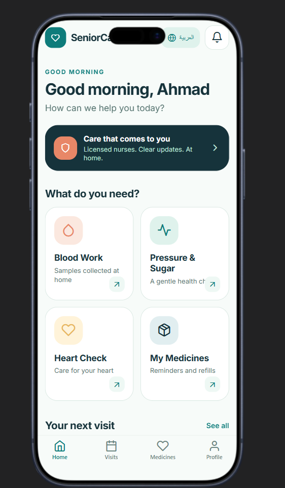

<div align="center">

# 🩺 SeniorCare

### Care that comes to you.

**A calm, accessible mobile app that lets seniors book licensed nurses for at-home health visits — in English and Arabic.**


-0E7C7B)

</div>

<div align="center">

</div>

---

## ✨ What is SeniorCare?

Getting to a clinic isn't always easy for older adults. **SeniorCare** brings the care to their front door: pick a service, choose a day and time, and a verified nurse shows up at home. Every screen is designed to be large, clear, and stress-free — with no passwords to remember.

## 🚀 Features

| | Feature | Details |
|---|---|---|
| 🏠 | **Home dashboard** | Friendly greeting, "Care that comes to you" banner, and your next confirmed visit at a glance |
| 🩸 | **Book at-home services** | Blood Work, Pressure & Sugar, Heart Check, and Medicines review |
| 📅 | **Simple scheduling** | Pick Today/Tomorrow and a time slot — confirmed instantly |
| 🗓️ | **Visits tab** | See all upcoming visits, with cancel/reschedule guidance |
| 💊 | **Medicines tab** | Daily dose tracker with progress and refill reminders |
| 👤 | **Profile** | Personal info, address, connected family & caregivers, emergency help |
| 🔐 | **Passwordless sign-in** | Phone number + 4-digit verification code, with family-member and nurse entry points |
| 🌍 | **Bilingual + RTL** | Full English and Arabic translations with proper right-to-left layout, switchable in one tap |
| 💾 | **Persistent state** | Language and booked visits are saved on-device with AsyncStorage |
| 🌗 | **Light/dark aware** | Semantic color tokens and automatic UI style |

## 🛠️ Tech Stack

- **Mobile app:** Expo 54 · React Native 0.81 · Expo Router (typed routes) · React Compiler · Reanimated · Inter font
- **API:** Express 5 (bundled with esbuild)
- **Database:** PostgreSQL + Drizzle ORM
- **Contracts:** OpenAPI spec → [Orval](https://orval.dev) generates a React Query client and Zod schemas
- **Tooling:** pnpm workspaces · TypeScript 5.9 · Prettier

## 🗂️ Project Structure

```
SeniorCare/
├── artifacts/
│   ├── seniorcare/        # 📱 Expo mobile app (the main product)
│   │   ├── app/           #    File-based routes: sign-in, (tabs)/, request/[service]
│   │   ├── components/    #    Shared UI (buttons, headings, error boundary)
│   │   ├── context/       #    SeniorCareContext – state + EN/AR copy
│   │   ├── constants/     #    Design tokens (colors)
│   │   └── server/        #    Static server + landing page for web builds
│   ├── api-server/        # 🖥️ Express 5 API
│   └── mockup-sandbox/    # 🎨 Vite + shadcn/ui playground for UI mockups
├── lib/
│   ├── api-spec/          # OpenAPI spec + Orval config
│   ├── api-client-react/  # Generated React Query hooks
│   ├── api-zod/           # Generated Zod schemas
│   └── db/                # Drizzle ORM schema & config
└── scripts/               # Workspace utility scripts
```

## 🏁 Getting Started

### Prerequisites

- **Node.js** 24+
- **pnpm** (the repo enforces it — npm/yarn will refuse to install)
- **PostgreSQL** (only needed for the API server)

### Install

```bash
pnpm install
```

### Run the app

```bash
# Mobile app (Expo)
pnpm --filter @workspace/seniorcare run dev

# API server (port 5000)
pnpm --filter @workspace/api-server run dev
```

> The `dev` script uses Replit environment variables (`$PORT`, `$REPLIT_DEV_DOMAIN`, …). Outside Replit, run `pnpm exec expo start` from `artifacts/seniorcare` instead.

### Useful commands

| Command | What it does |
|---|---|
| `pnpm run typecheck` | Typecheck every package |
| `pnpm run build` | Typecheck + build all packages |
| `pnpm --filter @workspace/api-spec run codegen` | Regenerate API hooks & Zod schemas from `openapi.yaml` |
| `pnpm --filter @workspace/db run push` | Push DB schema changes (dev only) |

**Environment:** set `DATABASE_URL` to your Postgres connection string.

## 🎨 Design Principles

- **Big, readable type** and generous touch targets for every control
- **Calm teal & seafoam palette** — reassuring, never clinical
- **One thing per screen** — no clutter, no jargon
- **Privacy first** — "Your health information is private and protected."

## 🗺️ Roadmap

- [ ] Real phone/OTP authentication
- [ ] Family-member access with patient approval
- [ ] Nurse provider portal
- [ ] Medicine reminders & push notifications
- [ ] Live visit tracking ("Nurse is on the way")
- [ ] Backend persistence for visits and profiles

## 📄 License

MIT

---

<div align="center">
Made with 💚 for the people who cared for us first.
</div>
